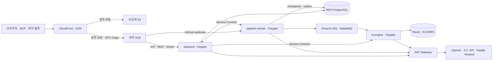

# whycode AWS 전환 계획

2026-11-10 · 착수 전 · 기준 브랜치 `develop`

서울 리전(`ap-northeast-2`)에서 `why-code.com`을 **1주일(168시간) 운영**한 뒤 홈서버로 돌린다. AWS에서 운영 쓰기를 개방한 시각을 시작점으로 기록한다. 그 전에 별도 스테이징에서 수집·질의, 양방향 복원과 장애 대응을 재현한다. 운영 예산은 리허설과 종료 작업까지 합산하고, 실제 개방 일시와 허용 중단 시간은 리허설 뒤 확정한다. 학습 완료는 AWS에서 실제 요청을 처리하고, 홈서버 복귀와 리소스 정리까지 검증한 것으로 판정한다.

## 1. 목표 구성

| 구간 | 선택 | 직접 해볼 작업 |
|---|---|---|
| 계정과 권한 | IAM, GitHub Actions OIDC, Secrets Manager, KMS | 임시 배포 권한 발급, 앱별 비밀 읽기 권한 분리, 비밀 갱신 후 태스크 교체 |
| 네트워크 | VPC, 2개 AZ, Security Group, NAT Gateway, S3 Gateway Endpoint | 서브넷·라우팅 구성, 허용 포트와 외부 API egress 확인, NAT 비용 측정 |
| 공개 진입점 | Route 53, ACM, CloudFront, S3, ALB | 스테이징 서브도메인 위임, 인증서 검증, 정적 캐시 확인, 경로별 라우팅과 원본 접근 차단 |
| 컨테이너 | ECR, ECS Fargate, Service Connect | SHA/다이제스트 배포, 태스크 교체, 내부 이름으로 호출, 이전 이미지 복구 |
| 데이터 | RDS PostgreSQL 16, Amazon MQ for RabbitMQ, EC2 + 암호화된 gp3 EBS | RDS 시점 복구, MQ 재연결·DLQ 복구, Neo4j를 새 EBS/인스턴스에 복원 |
| 운영 | Systems Manager Session Manager, CloudTrail, CloudWatch, SNS, AWS Budgets | SSH 없이 운영 접속, 배포 역할의 API 호출 추적, 장애 알람과 실청구 확인 |

기존 [배포 가이드](deployment.md)의 홈서버를 전환 전 운영 원본으로 삼는다. Route 53은 `aws.why-code.com` 위임 구역에서 먼저 사용한다. 운영 전환은 기존 DNS 관리처에서 `why-code.com`의 레코드만 바꾸는 안으로 잡고, 콜백·웹훅·MCP issuer 주소를 유지한다. Cloudflare를 DNS로 유지한다면 CloudFront 앞 레코드는 DNS-only로 검증한다. CloudFront용 ACM 인증서는 `us-east-1`, HTTPS ALB용은 서울에 발급한다. [CloudFront VPC origins](https://docs.aws.amazon.com/AmazonCloudFront/latest/DeveloperGuide/private-content-vpc-origins.html) · [CloudFront 인증서 요건](https://docs.aws.amazon.com/AmazonCloudFront/latest/DeveloperGuide/cnames-and-https-requirements.html)

1주 운영의 기준안은 **Amazon MQ와 관리형 NAT를 포함한 아래 구성**이다. 1주 안에 관리형 브로커와 네트워크도 경험할 수 있도록 잡았다. 예산이 우선이면 §5의 RabbitMQ 직접 운영안을 선택한다. RDS와 브로커는 비공개 Single-AZ, Neo4j는 EC2 한 대, Fargate는 서비스당 태스크 한 개로 시작한다. 내부 ALB는 2개 AZ에 걸친다. 앱 서브넷의 외부 경로는 NAT 한 개로 두므로 해당 AZ나 NAT 장애 시 수집·추론이 중단될 수 있다. 1주 실측 결과를 바탕으로 이후 상시 운영과 고가용성 도입 여부를 결정한다.

### 데이터 서비스 선택

- **RDS PostgreSQL**에 backend와 worker가 공유하는 DB 하나를 옮긴다. 현재 메이저 버전 16과 Flyway 이력을 유지하고, 마이그레이션 역할과 런타임 역할을 분리한다.
- **Amazon MQ**에 현재 아웃박스와 AMQP 계약을 연결한다. RabbitMQ 4.3/m7g를 첫 검증 후보로 두고 서울의 실제 생성 가능 조합을 확인한다. `mq.m7g.medium`은 실습용 후보, `mq.m7g.large`는 운영 견적의 시작점이다. SQS와 Lambda는 별도 실습에서 다룬다. [브로커 버전 관리](https://docs.aws.amazon.com/amazon-mq/latest/developer-guide/rabbitmq-version-management.html) · [브로커 인스턴스 유형](https://docs.aws.amazon.com/amazon-mq/latest/developer-guide/rmq-broker-instance-types.html)
- **Neo4j 5.26 Community**는 현재 실행 중인 패치와 이미지 다이제스트를 확인해 같은 버전으로 EC2에 복원한다. Neo4j의 Cypher 제약과 벡터 프로시저를 사용하므로 Neptune 도입은 별도 애플리케이션 검증 과제로 둔다. Aurora·EKS·ElastiCache도 초기 운영 단계에서는 의존성을 추가할 구체적인 요구가 생긴 뒤 평가한다. [현재 벡터 스키마](../services/ai-engine/graph/schema.py) · [Neptune 마이그레이션 호환성](https://docs.aws.amazon.com/neptune/latest/userguide/migration-compatibility.html)

## 2. 구현 순서와 단계별 완료 조건

한 묶음씩 구현·리뷰한다. `AWS2`, `AWS3a`, `AWS3b`는 독립 스테이징이나 Compose에서 병렬로 진행할 수 있다. `AWS3c`가 브로커와 두 서비스의 변경을 합친다. Java 계약 변경은 `spring-test-writer`가 실패를 재현한 뒤 `implementer`가 구현한다.

| 묶음 | 무엇을 왜 하는가 | 작업 단위와 선행 조건 | 완료 조건 |
|---|---|---|---|
| **AWS0 기준선·계정** | 비용과 복구 시간을 비교할 기준을 남긴다. | 오케스트레이터. 운영 리소스 사용량, DB/그래프 크기, 큐 수·메시지 크기, 요청 지연, 백업 소요를 수집한다. 스테이징에 샘플 데이터·테스트용 외부 앱을 준비한다. | 기준표와 전체 예산 후보, AWS 시작·복귀 일정, 비용 알림 수신자, 리전·브로커 가용 옵션을 기록했다. |
| **AWS1 기반** | 환경을 삭제·재생성하고 배포 권한을 제한할 수 있게 한다. | 인프라 구현자 · AWS0 뒤. Terraform으로 VPC, SG, NAT, IAM/OIDC, 비용 태그, 로그 그룹, ECR을 만든다. 환경별 상태를 분리하고 S3 상태 버킷에 암호화·버전 관리·잠금(`use_lockfile`)을 적용한다. | 같은 입력으로 plan이 수렴하고, 허용된 GitHub 환경만 배포 역할을 맡는다. 테스트 태스크의 ECR pull과 외부 API egress, SG 차단을 확인했다. |
| **AWS2 웹·진입점** | 컨테이너 밖에서 SPA를 제공하고 동일 출처의 API를 유지한다. | 웹·엣지 구현자 · AWS1 뒤. Route 53 위임, 인증서, OAC, CloudFront 동작, 내부 ALB를 샘플 타깃으로 확인한다. | 정적 응답은 캐시되고 API는 캐시되지 않는다. 브라우저와 다른 사용자 요청, 경로별 401·404, 내부 경로 차단을 확인했다. |
| **AWS3a PostgreSQL** | DB 데이터를 옮기고 Flyway가 한 번만 실행되게 한다. | 인프라 및 backend 구현자 · AWS1 뒤. RDS, TLS, 권한, 이전·복원 작업을 구성한다. | 새 DB에 덤프를 복원하고 Flyway 검증·RDS PITR을 실행했다. 두 서비스의 권한과 애플리케이션 읽기·쓰기가 정상이다. |
| **AWS3b 그래프** | 그래프와 수동 결정 데이터를 보존한다. | 데이터 인프라 구현자 · AWS1 뒤. EC2·EBS·SSM, S3 백업, 새 볼륨으로 복원을 실습한다. | 외부 포트 없이 SSM으로 접속했다. 노드·관계 집계와 수동 결정이 일치하고, 벡터 검색과 대표 질의가 작동한다. |
| **AWS3c 수집 브로커** | 관리형 브로커에서도 발행·순서·실패 격리 계약을 재현한다. | 인프라·worker·ai-engine 구현자 · AWS1 뒤, 로컬 호환성부터 착수. TLS, 큐 발견, prefetch, DLX 정책을 검증한다. | 실제 Amazon MQ에서 수집, 순서, 공정성, 큐 제한, 재연결, 미확인 발행 재처리와 DLQ 재생을 확인했다. |
| **AWS4 앱 배포** | 이미지와 스키마 버전을 추적하고 실패한 배포를 복구한다. | 인프라·배포 및 앱 구현자 · AWS2, AWS3a~c 뒤. ECR 푸시, 마이그레이션, Fargate 배포, 정적 자산 발행을 연결한다. 신규 작업 차단과 스케줄러·relay·consumer 중지 모드를 만든다. | 외부에 유지보수를 응답하는 상태에서 DB·그래프를 조회해 준비 상태를 확인했다. 이전 이미지·웹 릴리스 복귀를 재현했고, 태스크 강제 종료 후 누락·중복을 대조했다. |
| **AWS5 운영 리허설** | 장애를 발견하고 홈서버 복귀까지 걸리는 시간을 잰다. | 운영자 · AWS4 뒤. 스테이징에서 AWS에 쓰기를 발생시킨 뒤 홈서버의 새 볼륨에 역복원한다. | §5 점검표를 통과했고 양방향 중단 시간과 리허설·운영 합산 견적이 합의한 기준 안에 있다. |
| **AWS6 운영 전환** | 기존 URL로 들어오는 트래픽을 AWS로 옮긴다. | 운영자 · AWS5 뒤. §6에 따라 쓰기 중지, 최종 복원, 트래픽 개방, 배송 대조를 진행한다. | 로그인·질의·수집·MCP·활성 웹훅이 운영 도메인에서 통과하고, 전환 구간 배송이 모두 대조됐다. |
| **AWS7 1주 운영·종료** | 운영 중 생긴 데이터를 가져오고 과금을 끝낸다. | 운영자 · AWS6 뒤. §7에 따라 지표를 수집하고, 홈서버 역이전과 임시 인프라 정리를 수행한다. | 홈서버에서 최신 데이터와 배송을 대조했고, 보존 대상과 잔존 비용을 기록했다. |

Terraform이 리소스와 비밀 ARN을 관리하고 실제 값은 별도 권한으로 Secrets Manager에 적재한다. GitHub OIDC 역할은 저장소와 배포 환경을 제한하고, 인프라 적용·이미지 발행·ECS 배포 권한을 구분한다. 운영에는 테스트를 통과한 다이제스트를 올린다. 백엔드 Flyway와 worker 시작 순서에 관한 기존 Compose 의존성은 동일 릴리스의 일회성 마이그레이션과 성공 확인으로 옮긴다. AWS의 앱 태스크는 스키마 검증만 하며, 스키마가 바뀌는 배포는 이전 이미지와 호환되는지 확인한 뒤 복귀 절차를 정한다. [GitHub OIDC 신뢰 정책](https://docs.aws.amazon.com/IAM/latest/UserGuide/id_roles_create_for-idp_oidc.html) · [Terraform S3 상태](https://developer.hashicorp.com/terraform/language/backend/s3) · [현재 Compose 의존성](../infra/docker/docker-compose.yml)

## 3. 앱·엣지에서 확인할 계약

### 경로와 인증

| 요청 | AWS의 처리 |
|---|---|
| `/`, `/auth/callback`, `/mcp/setup` 등 웹 라우트 | 비공개 S3 REST 오리진 + OAC. 정적 동작에서 React Router의 허용 경로만 `/index.html`로 재작성한다. `/assets/*`, `robots.txt`, `sitemap.xml`과 실제 파일은 그대로 보낸다. |
| `POST /api/v1/webhook/github` | ALB에서 경로·메서드가 일치할 때만 worker에 전달한다. 원문 바이트와 서명 헤더를 보존하고 최대 크기 근처의 요청으로 확인한다. |
| `/api/*`, `/mcp`, `/oauth2/*`, `/.well-known/*` | ALB에서 backend로 전달한다. Slack Events·Commands와 Paddle 웹훅도 이 경로다. 캐시는 끄고 Authorization, 쿠키, 쿼리, 메서드, 서명 헤더를 전달한다. |
| `/mcp/`, `/api/v1/internal/*`, worker의 `/api/v1/collect/*`·`/api/v1/raw/*`, 미등록 webhook 경로 | `/mcp/`는 기존 JSON 404를 유지한다. 내부·미등록 경로는 공개 리스너에서 차단한다. `/api/*` 허용 규칙보다 우선한다. |

- OAC는 CloudFront 배포만 S3에서 읽게 하는 권한 제어다. S3 직접 접근과 ALB 우회 접근을 테스트한다. 배포는 해시가 붙은 자산을 먼저 올리고 `index.html`을 나중에 교체한다. 이전 릴리스가 참조하는 자산은 복귀 기간 동안 보관한다. 전체 배포에 걸친 SPA 오류 치환은 사용 범위에서 제외한다. [S3 원본 제한](https://docs.aws.amazon.com/AmazonCloudFront/latest/DeveloperGuide/private-content-restricting-access-to-s3.html) · [현재 Nginx 경로와 보안 헤더](../clients/web-dashboard/nginx.conf)
- 동적 동작에서 `Host`를 전달해 ALB 인증서와 일치시키고, viewer-request 함수에서 허용 도메인만 받는다. 수정 가능한 `Forwarded` 등 클라이언트 전달 헤더를 제거하고 `X-Whycode-Client-IP`를 `event.viewer.ip`로 덮어쓴다. `X-Forwarded-Proto`는 HTTPS ALB가 기록하는 값을 쓴다. ALB는 VPC Origin 서비스 SG에서만 받고, backend의 `MCP_OAUTH_CLIENT_IP_HEADER`에 전용 IP 헤더를 지정한다. 위조 헤더로 IP 상한을 우회할 수 없는지와 `Secure` 쿠키를 실측한다. [ALB와 CloudFront의 HTTPS](https://docs.aws.amazon.com/AmazonCloudFront/latest/DeveloperGuide/restrict-access-to-load-balancer.html) · [클라이언트 IP 함수 예제](https://docs.aws.amazon.com/AmazonCloudFront/latest/DeveloperGuide/example_cloudfront_functions_add_true_client_ip_header_section.html)
- CloudFront 응답 헤더 정책으로 Nginx의 CSP·보안 헤더를 이전한다. 폰트와 Paddle 샌드박스 창까지 브라우저에서 확인한다. OAuth 코드·쿠키·인증 헤더·웹훅 본문은 로그에서 제외한다. 엣지와 ALB 로그 활성화 전 URL·쿼리 포함 여부와 접근·보존 정책을 확인한다.

### 긴 질의와 태스크 교체

- backend의 AI 읽기 제한은 현재 120초다. ALB idle timeout 기본 60초와 CloudFront origin 응답 기본 30초를 올린다. 긴 질의가 지나는 backend·AI의 Service Connect 포트는 TCP로 구성해 HTTP 기본 요청 제한 15초를 피한다. 실측으로 앱 종료가 가장 먼저 일어나는지 확인한다. CloudFront의 기본 응답 제한 상한 120초에는 여유가 없으므로 상향 승인·실제 적용 여부를 확인한다. 적용할 수 없다면 운영 전환을 보류하고, AWS에서만 앱 제한을 낮추는 안을 질의 실측과 함께 결정한다. 브라우저 `/api`와 MCP에서 60초 이상 걸리는 성공 요청과 앱 타임아웃 응답을 둘 다 검증한다. [CloudFront 제한](https://docs.aws.amazon.com/AmazonCloudFront/latest/DeveloperGuide/cloudfront-limits.html) · [ALB idle timeout](https://docs.aws.amazon.com/elasticloadbalancing/latest/application/edit-load-balancer-attributes.html) · [Service Connect 제한](https://docs.aws.amazon.com/AmazonECS/latest/developerguide/service-connect-concepts-deploy.html)
- ALB는 backend·worker의 내부 준비 상태만 확인한다. 현재 backend는 TCP 확인을 쓰고 ai-engine `/health`만으로는 MQ 준비 여부를 알 수 없다. 새 리비전의 트래픽 개방은 DB 스키마, 브로커, Neo4j 초기화와 대표 smoke 테스트까지 확인한다. 일시적인 외부 API 장애는 프로세스 liveness와 분리한다.
- backend의 동의 티켓·rate limit, worker의 프로젝트 직렬화·아웃박스 릴레이, AI의 소비·그래프 빌드 상태에 프로세스 로컬 전제가 있다. 태스크 한 개 설정에 더해 신규 작업을 멈추고 진행 중인 작업을 소진한 뒤 이전 태스크 종료를 확인하고 교체한다. Fargate 종료 유예는 최대 120초이고 worker executor의 대기 설정은 300초다. 종료 시그널에 의존하지 않고 선행 차단·드레인·배송 복구를 만든다. 오토스케일링과 무중단 다중 태스크 롤링은 상태 공유·작업 소유권 검증 이후 과제다. [ECS 태스크 설정](https://docs.aws.amazon.com/AmazonECS/latest/developerguide/task_definition_parameters.html)

## 4. 데이터별 이전과 검증

### RDS PostgreSQL

- `pg_dump -Fc`와 `pg_restore --no-owner --no-acl`로 새 DB에 복원한다. `pgcrypto`, `citext`, `pg_trgm`과 확장·스키마 소유권을 확인한다. Flyway 이력을 함께 보존하고 `validate` 후 시작한다. backend와 worker는 RDS CA로 서버 이름까지 검증하는 TLS(`sslmode=verify-full`)로 접속한다. [RDS 확장](https://docs.aws.amazon.com/AmazonRDS/latest/UserGuide/PostgreSQL.Concepts.General.FeatureSupport.Extensions.html) · [RDS PostgreSQL TLS](https://docs.aws.amazon.com/AmazonRDS/latest/UserGuide/PostgreSQL.Concepts.General.SSL.html)
- 사용자·프로젝트·대화·연동·결제·MCP 연결·checkpoint·webhook delivery·outbox의 건수와 주요 키를 대조한다. `BACKEND_CREDENTIAL_KEY`, JWT/MCP 서명키, 활성 provider의 OAuth·웹훅 설정을 이어 받아 기존 연동 복호화와 토큰·웹훅 검증을 확인한다. 키와 덤프는 별도 권한으로 관리한다. 스테이징에는 별도 키와 테스트 계정으로 만든 자격증명만 넣는다.

### Amazon MQ

- worker와 ai-engine의 AMQP 연결을 AMQPS 5671로 맞춘다. AI 큐 발견은 AMQP 호스트에 HTTP 15672를 붙이는 현재 방식에서 명시적인 HTTPS 관리 API 주소(443 또는 15671), 인증 정보, vhost를 받는 방식으로 바꾼다. 접속 비밀은 URL과 분리하고 인증서 검증과 특수문자 비밀번호를 시험한다. 기존 Compose 연결 계약도 검증한다. [Amazon MQ RabbitMQ 포트와 프로토콜](https://docs.aws.amazon.com/amazon-mq/latest/developer-guide/working-with-rabbitmq.html) · [현재 큐 발견 구현](../services/ai-engine/graph/queue_discovery.py)
- RabbitMQ 4 계열의 기본 quorum 큐와 redelivery limit를 실제 생성된 정책에서 확인한다. 4.3에서 제거된 global QoS를 걷어내면서 프로젝트별 순서·공정성과 전체 미확인 메시지 상한을 보존한다. 기존 durable 큐 선언과 삭제, single-active-consumer, publisher confirm·return, TTL 재시도, dead-letter 전략과 중복 처리를 시험한다. 프로젝트 큐와 재시도 큐의 합, 채널당 소비자 수, 최대 이벤트 바이트를 기본 제한과 비교한다. 큐별 알람은 4 계열에서 관리 API 계측으로 구성하고 CloudWatch 브로커 지표와 구분한다. [RabbitMQ 4.3 변경](https://docs.aws.amazon.com/amazon-mq/latest/developer-guide/rabbitmq-43.html) · [브로커 자원 제한](https://docs.aws.amazon.com/amazon-mq/latest/developer-guide/rabbitmq-resource-limits-configuration.html) · [RabbitMQ 4 운영 차이](https://docs.aws.amazon.com/amazon-mq/latest/developer-guide/rabbitmq-4.html)

### Neo4j와 복구 시점

- Neo4j는 public IP 없는 EC2에서 실행하고, AI의 SG만 Bolt에 접근하게 한다. 인스턴스에는 SSM으로 들어간다. Community의 오프라인 `neo4j-admin database dump/load`를 그대로 적용하고 KMS로 암호화한 별도 S3 버킷에 체크섬과 함께 보관한다. AWS에서 새 인스턴스나 볼륨에 실제 복원한다. [현재 백업 스크립트](../infra/scripts/backup.sh) · [Neo4j Docker 덤프·복원](https://neo4j.com/docs/operations-manual/current/docker/dump-load/)
- 노드·관계 유형별 건수와 `ActorDecision`, `IngestTombstone`, 대표 프로젝트 범위를 비교한다. `comm_embedding`, `issue_embedding`, `doc_section_embedding`이 모두 `ONLINE`이고 대표 벡터 검색 결과가 맞아야 consumer를 연다.
- 정기 백업에는 PostgreSQL과 Neo4j의 공통 복원 시각, 이미지 다이제스트, 아웃박스·큐 상태를 기록한다. RDS PITR로 더 최근 DB를 복원할 경우 checkpoint가 그래프를 앞설 수 있으므로 누락 구간을 식별해 재처리할 수 있을 때만 사용한다. 복구 시간과 허용 데이터 손실 범위는 이 리허설의 측정값으로 정한다.

## 5. 비용과 운영 리허설

### 1주 운영 예산

| 항목 | 스테이징 견적 | 운영 168시간 견적 입력 |
|---|---|---|
| Fargate Linux/x86 | 예시 40시간, 서비스당 1개 | backend `0.5 vCPU/2 GiB`, worker `1 vCPU/2 GiB`, AI `0.5 vCPU/2 GiB` × 각 168시간. 총 336 vCPU-시간과 1,008 GiB-시간 |
| RDS·Amazon MQ | `db.t4g.small`, `mq.m7g.medium` 후보 | RDS PostgreSQL `db.t4g.small` + gp3 20 GiB, MQ `mq.m7g.large` + 기본 저장소 200 GB, 둘 다 Single-AZ |
| EC2·EBS | Neo4j 복원 실습 시간과 스냅샷 | Linux x86 `t3.large`, 암호화 gp3 40 GiB 시작값. 디스크 크기는 운영 볼륨과 복원 여유 실측으로 확정 |
| ALB·NAT | 생성~삭제까지 전체 시간 | 내부 ALB와 NAT 각 1개, ALB LCU, NAT 처리 GB·공인 IPv4·교차 AZ 전송료, 인터넷 송신량 |
| 나머지 | 정적 웹·로그·백업·이미지 저장량 | CloudFront 요청·송신, S3 요청·보존·백업, ECR, CloudWatch 수집·보존, Secrets Manager, KMS, Route 53, SNS, 스냅샷과 CPU 크레딧 |

| 구성 | 168시간 운영, 세전 | 부가세 포함 환산 |
|---|---:|---:|
| **학습 기준안** · Amazon MQ, Fargate, RDS, CloudFront·S3·ALB, NAT | **$130~140** | 약 19만~21만 원 |
| 절감안 · Neo4j용 EC2에 RabbitMQ와 전용 gp3 볼륨 추가, 나머지 AWS 앱·엣지·DB 구성 사용 | $65~75 | 약 9.7만~11.1만 원 |
| 비용 우선안 · EC2 `t3a.xlarge`의 Compose + RDS + 기존 Cloudflare Tunnel | $45~50 | 약 6.7만~7.4만 원 |

서울 On-Demand 단가와 낮은 트래픽, `$1 = ₩1,350`, 부가세 10%를 가정한다. 기준안의 주요 기본료는 168시간에 약 `$125`이며, 이 중 MQ가 약 `$62`다. 절감안은 Neo4j와 RabbitMQ가 동일 EC2를 공유하므로 초기 수집과 그래프 질의를 동시에 실행해 CPU·메모리·디스크를 검증한다. 관리형 MQ 실습은 이 경우에도 스테이징에서 수행할 수 있다. [서울 MQ 가격표](https://pricing.us-east-1.amazonaws.com/offers/v1.0/aws/AmazonMQ/current/ap-northeast-2/index.json) · [서울 Fargate 가격표](https://pricing.us-east-1.amazonaws.com/offers/v1.0/aws/AmazonECS/current/ap-northeast-2/index.json) · [서울 EC2·EBS 단가](https://aws-pricing.com/ap-northeast-2.html) · [AWS 부가세 안내](https://aws.amazon.com/tax-help/apac-vat-rates/)

별도 40시간 스테이징은 `$25~35`다. 기준안과 합산하면 **세전 `$155~175`**이며, 과금 시간은 리소스 생성부터 삭제까지이므로 전환 준비·복귀·삭제 대기와 종료 후 보존은 별도로 산정한다. OpenAI 등 외부 API 비용도 구분한다. CloudFront는 종량제로 구성하고, [AWS Pricing Calculator](https://calculator.aws/)에 전체 예산을 기록한다. `Environment` 비용 태그와 Budgets 알림을 설정하고 운영 중 Cost Explorer로 대조한다. 알림에는 집계 지연이 있으므로 종료 일정과 유료 리소스 목록을 따로 관리한다. [CloudFront 요금](https://aws.amazon.com/cloudfront/pricing/) · [VPC 과금](https://aws.amazon.com/vpc/pricing/) · [AWS Budgets](https://docs.aws.amazon.com/cost-management/latest/userguide/budgets-managing-costs.html)

### 전환 전 통과 조건

- **사용 경로** · GitHub 로그인과 새로고침, 활성 연동의 OAuth 콜백, 대표 초기 수집과 GitHub PR 머지 증분, 그래프·검색·질의, MCP discovery·연결·질의·토큰 갱신·철회, Slack Events·Commands, Paddle 샌드박스·서명 웹훅을 확인한다. 운영에서 활성화된 경로는 [콜백 등록표](deployment.md#3-외부-콘솔-등록-체크리스트)와 대조한다.
- **장애와 복구** · 태스크 종료, MQ 연결 단절, DB 복원, 새 Neo4j 볼륨 복원, 이전 릴리스 복귀를 연습한다. CloudWatch에서 ALB 5xx·지연·타깃 상태, ECS 재시작, RDS 여유 공간, outbox 미발행 최장 시간, 큐 적체·DLQ·parking, 백업 경과 시간에 대한 알람을 SNS로 수신한다. 기준값은 평시·초기 수집 버스트를 실측해 확정한다.
- **운영 결정** · 스테이징과 1주 운영의 합산 예산, 쓰기 개방·복귀 시각, 허용 중단 시간, 목표 RPO·RTO와 백업 보존 기간을 기록한다. 스테이징 결과가 기준을 넘으면 용량이나 전환 절차를 조정하고 재실측한다. 운영 데이터 적재 전 AWS 위탁·로그·백업 위치와 보존 정책을 현재 개인정보 안내와 대조한다.

핵심 스택을 익힌 뒤에는 별도 스테이징에서 **EventBridge Scheduler → SQS → Lambda**로 가짜 백업 완료 이벤트를 처리한다. 동일 이벤트를 두 번 보내고 Lambda를 실패시켜 재시도와 DLQ 재생을 확인한다. DynamoDB는 실습을 확장할 때 이벤트 ID로 중복 처리 방지를 시험하는 용도로 쓴다. 실습 데이터는 식별자가 없는 합성 데이터로 두고 종료 후 리소스를 삭제한다.

## 6. 운영 전환과 복귀

1. **리허설** · 스테이징에서 가용 옵션, 최종 덤프·복원 시간과 체크섬, 운영과 같은 호스트 규칙, 실수집·질의를 확인한다. 기존 DNS 레코드와 복원 절차를 보관하고 가능한 경우 전환 전에 TTL을 줄인다. 전환 시점 배포 다이제스트를 고정한다.
2. **신규 작업 차단** · 홈서버의 동적 진입점을 유지보수 503으로 전환해 웹훅과 GET OAuth 콜백까지 차단한다. 예약 작업과 신규 수집도 중지한다. 이미 2xx를 돌려준 웹훅과 초기 수집은 인메모리 실행기에서 진행 중일 수 있다. 실행기와 DB의 진행 중 작업을 먼저 확인한다.
3. **드레인** · 홈서버의 relay와 consumer를 유지해 미발행 outbox가 0이고 모든 프로젝트·재시도 큐의 ready/unacked가 0인지 확인한다. AI의 지연 그래프 작업까지 끝낸다. `published_at`은 브로커 발행 확인 시각이다. DLQ·parking은 ID·헤더·건수를 대조하고 처리 또는 암호화 보존 경로를 정한다. 정해진 시간 안에 드레인되지 않으면 기존 서비스를 복구하고 전환을 재예약한다. [수집 큐 운영 절차](ingestion-queue-architecture.md)
4. **최종 스냅샷과 복원** · 모든 기존 쓰기 프로세스를 차단한 뒤 PostgreSQL과 Neo4j의 같은 정지 시점 덤프를 만든다. AWS에 복원하고 §4 대조를 마친다. 스케줄러와 consumer는 검증이 끝날 때까지 차단하고 외부에는 유지보수를 응답한다.
5. **트래픽 전환** · 운영 호스트명으로 새 CloudFront의 인증서·OAuth 메타데이터·비공개 경로 차단을 확인하고, DB·그래프는 운영자 경로에서 읽기 전용으로 대조한다. 동일 도메인의 DNS 목적지를 CloudFront로 바꾸고 홈서버는 쓰기 차단 상태로 유지한다. AWS에서만 쓰기·예약 작업·웹훅을 열고 개방 시각을 기록한 뒤 운영 계정의 로그인·토큰 갱신·질의와 증분 수집을 확인한다. GitHub 실패 배송은 재전송 가능한 기간 안에 ID로 직접 재전송한다. 이전에 2xx를 받은 실패 건은 DB 상태와 소스 원본을 대조해 증분 또는 보정 수집한다. 다른 활성 provider도 배송·서명·중복 처리와 소스 원본을 확인한다. [GitHub 실패 배송 처리](https://docs.github.com/en/webhooks/using-webhooks/handling-failed-webhook-deliveries) · [GitHub 재전송 기간](https://docs.github.com/en/webhooks/testing-and-troubleshooting-webhooks/redelivering-webhooks)
6. **조기 복귀 판단** · AWS 쓰기 개방 전에는 홈서버의 쓰기를 재개하고 DNS를 돌린 뒤 중단 구간 배송을 대조한다. AWS 쓰기 개방 이후에는 §7의 역이전으로 복귀한다. 역복원 검증이 실패하면 AWS 데이터를 보존하고 복귀를 연기해 복구한다.

## 7. 1주 운영과 종료

1. **운영 중** · 쓰기 개방 시각부터 168시간 뒤를 목표 종료 시각으로 기록한다. 매일 비용·오류율·질의 지연·outbox와 큐 적체를 확인하고, 실패한 배송은 provider의 재전송 가능 기간 안에 대조한다. 역이전 리허설에 사용한 이미지와 호환되는 스키마·DB 버전·키를 유지한다. 종료 하루 전에 홈서버 용량, 터널과 기존 DNS 레코드, 덤프 전송·복원 소요를 다시 확인한다.
2. **최종 덤프** · 종료 창에 AWS 동적 진입점과 예약 작업을 멈춘 뒤 실행기를 비우고 §6의 드레인 조건을 AWS에서 적용한다. DLQ·parking의 처리 또는 보존 대상을 기록한다. 모든 쓰기를 멈춘 같은 시점의 RDS `pg_dump -Fc`와 Neo4j 오프라인 덤프를 암호화해 AWS 밖으로 옮긴다. 덤프 체크섬과 별도 보관한 자격증명 복호화 키를 확인한다.
3. **홈서버 복귀** · 새 DB에는 `pg_restore --no-owner --no-acl --exit-on-error`로 복원하고, Neo4j는 새 볼륨에 복원한다. Flyway, DB 건수·checkpoint, 그래프·벡터 인덱스, 연동 복호화와 AWS에서 추가된 데이터의 조회를 점검한다. 검증을 통과하면 기존 터널 DNS로 돌리고 홈서버에만 쓰기를 허용한다. AWS는 유지보수 상태로 두고 DNS 전파 구간의 실패 배송을 재전송·대조한다. 운영 로그인·질의·웹훅을 다시 확인한다.
4. **유료 리소스 정리** · 홈서버 복귀와 백업 복원성을 확인한 뒤 임시 환경을 삭제한다. CloudFront는 비활성화·전파를 확인하고 제거하며, VPC Origin 연결을 해제한 뒤 ALB를 삭제한다. ECS, EC2, MQ, RDS, NAT와 남은 공인 IP를 확인한다. 보존할 RDS/EBS 스냅샷·S3 버전·ECR 이미지·로그·Route 53 위임 구역은 만료일과 비용을 기록한다. 암호화 백업이 참조하는 KMS 키는 복원 가능 기간까지 유지한다. 다음 비용 집계에서 삭제 대상 과금이 끝났는지 확인한다. [CloudFront 삭제](https://docs.aws.amazon.com/AmazonCloudFront/latest/DeveloperGuide/HowToDeleteDistribution.html) · [RDS 삭제와 백업](https://docs.aws.amazon.com/AmazonRDS/latest/UserGuide/USER_DeleteInstance.html) · [NAT 삭제](https://docs.aws.amazon.com/vpc/latest/userguide/nat-gateway-working-with.html)
